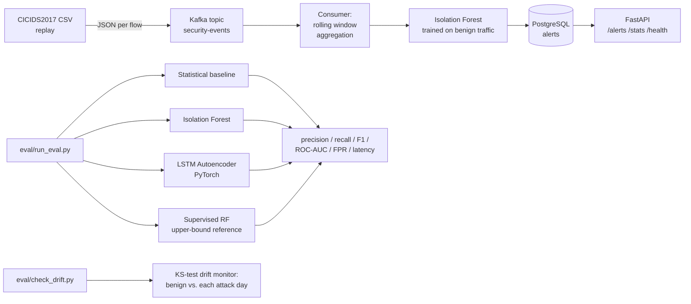

# NetSentinal AI 
Network Monitoring & Anomaly Detection using Machine Learning and DevOps


A streaming anomaly-detection pipeline over real, labeled network-traffic data: flow records are streamed through **Kafka**, aggregated into rolling behavioral windows, and scored by three independently evaluated detection approaches — a statistical baseline, an unsupervised **Isolation Forest**, and a **PyTorch LSTM autoencoder** over raw flow sequences — with a distribution-shift monitor watching for when the underlying traffic pattern has drifted enough to warrant retraining. Results and alerts are served over **FastAPI**, backed by **PostgreSQL**.

## Results at a glance

Trained on 52,947 benign-only rolling windows (Monday), evaluated on 51,179 held-out windows from two real labeled attack days (29,400 of them attack-containing):

| Detector | Precision | Recall | F1 | ROC-AUC | FPR | Latency/window |
|---|---|---|---|---|---|---|
| Statistical z-score baseline | 0.800 | 0.912 | **0.853** | 0.849 | 0.307 | 0.0002 ms |
| Isolation Forest (unsupervised) | 0.571 | 0.163 | 0.253 | 0.693 | 0.165 | 0.0095 ms |
| **LSTM autoencoder (PyTorch, unsupervised)** | 0.693 | 0.243 | 0.360 | 0.439 | 0.145 | 0.0389 ms |
| Random Forest (supervised, in-sample ceiling) | 1.0 | 1.0 | 1.0 | 1.0 | 0.0 | 0.0060 ms |

**The honest headline: the simplest approach won, and the neural model came in below random on ROC-AUC.** That is reported as-is, not hidden or re-run until it looked better — see [Why the LSTM underperformed](#why-the-lstm-autoencoder-underperformed-a-root-cause-not-a-shrug) for the root cause, which turns out to be a real, diagnosable property of this dataset rather than a training bug. The supervised Random Forest row is deliberately not a fair comparison — it's trained and evaluated on the same labeled data, included only as an in-sample ceiling reference for what's achievable if labels were available at training time (they normally aren't, for genuinely novel attacks).

## Why this dataset, and what it can and can't show

This project uses **CICIDS2017** (Canadian Institute for Cybersecurity, University of New Brunswick) — real captured network traffic with genuine, human-labeled attacks (DDoS, PortScan), not synthetic or self-injected anomalies. Three of its official CSVs are used:

- `Monday-WorkingHours` — 529,918 benign-only flows, used as the pure baseline for training every detector.
- `Friday-Afternoon-DDos` — 97,718 benign + 128,027 labeled DDoS flows.
- `Friday-Afternoon-PortScan` — 127,537 benign + 158,930 labeled PortScan flows.

**Important limitation, disclosed up front:** the publicly distributed, ML-ready version of this dataset strips source/destination IP, flow ID, and wall-clock timestamp — it ships only the ~80 CICFlowMeter statistical features per flow, plus a label. That means:
- There is no way to build genuinely IP-based or auth-log-based features (failed-login rate, per-device tracking) from this data — anything claiming that would be fabricated. The "behavioral" features here are legitimately derivable ones instead: traffic volume, inter-arrival-time deviation, TCP flag ratios, and destination-port breadth within a rolling window (see `src/schema.py` and `src/features.py` for the exact list and the reasoning).
- Row order is treated as flow-arrival order for windowing and for the Kafka replay, since no explicit timestamp survives — a reasonable assumption for this benchmark, not a guarantee.
- The Kafka producer **replays** this pre-captured, labeled dataset at a configurable rate; it is not a live packet capture. That's an honest description of what's being demonstrated: real streaming infrastructure and real detection logic, over real (if pre-recorded) attack traffic.

## Architecture



## Quickstart

```bash
python -m venv venv
venv/Scripts/activate  # or source venv/bin/activate on Linux/Mac
pip install -r requirements.txt

# Place the three CICIDS2017 CSVs (see "Why this dataset" above) in data/:
#   data/monday_benign.csv, data/friday_ddos.csv, data/friday_portscan.csv

python -m pytest tests/ -v          # 17 unit tests pass standalone; +1 Kafka integration test skips cleanly without a broker
python -m eval.run_eval             # real metrics against real labeled data
python -m eval.check_drift          # drift monitor demo
```

To run the live streaming path (requires a local or Docker Kafka broker on `localhost:9092`, and Postgres or the SQLite default):

```bash
docker-compose up -d kafka postgres      # or run Kafka locally (see below)
python -m src.producer --file friday_ddos.csv --rate 1000 --max-records 500
python -m src.consumer --max-windows 30
python -m uvicorn src.api:app
curl localhost:8000/stats
curl "localhost:8000/alerts?limit=3&anomalies_only=true"
```

**Real captured output from this exact sequence** (against a real local Kafka broker, not mocked):

```
$ python -m src.producer --file friday_ddos.csv --rate 1000 --max-records 500
Sent 500 records from friday_ddos.csv to topic 'security-events'

$ python -m src.consumer --max-windows 30
Training reference Isolation Forest on benign traffic (monday_benign.csv)...
Scored 30 windows, 19 flagged anomalous

$ curl localhost:8000/stats
{"total_windows_scored":30,"anomalies_flagged":19,"anomaly_rate":0.6333333333333333}

$ curl "localhost:8000/alerts?limit=3&anomalies_only=true"
[{"id":24,"detector":"isolation_forest_live","window_index":23,"anomaly_score":0.631,"is_anomaly":true,"dest_ports_touched":20}, ...]
```

A 63% anomaly rate here is expected, not a bug: this demo replayed 500 rows straight from the **DDoS day file**, which is majority-attack traffic by construction — it's a pipeline smoke test, not the evaluation. The real precision/recall numbers against a proper held-out split are in [Results at a glance](#results-at-a-glance).

**Running Kafka without Docker (this project's actual dev setup):** Kafka ships with native Windows `.bat` scripts, so a JVM + the Kafka binary is enough — no Docker required. One caveat worth documenting: Kafka's classpath-building script hits Windows' command-line length limit if the install path is long (e.g. nested deep inside `OneDrive\Desktop\...`), throwing a cryptic `The input line is too long` error. Fix: install Kafka and a JDK under a short path (e.g. `C:\kafka`, `C:\jdk17`) instead.

## Evaluation

`eval/run_eval.py` trains every detector on **benign-only** windows from Monday, then scores **held-out windows from the two labeled attack days** (DDoS + PortScan) — a real train/test split by day, not a random shuffle that could leak attack-adjacent benign patterns across the split. Full numbers are in [Results at a glance](#results-at-a-glance) above; raw output is also written to `eval/results.json`.

`eval/check_drift.py` runs a second, complementary check: does the KS-test drift monitor (`src/drift.py`) correctly flag each attack day as "drifted" relative to the benign training baseline, while staying quiet on a genuine benign control?

| Comparison | Drift flagged? |
|---|---|
| Benign (Monday) vs. DDoS day | **Yes** — 8/10 features drifted, p≈0.0 |
| Benign (Monday) vs. PortScan day | **Yes** — 8/10 features drifted, p≈0.0 |
| Benign vs. a random subsample of itself (specificity control) | **No drift** — 0/10 features flagged |
| Benign, first half of the day vs. second half (temporal check) | **Yes** — same 8/10 features drift |

The specificity control (random subsample) confirms the monitor doesn't cry wolf on ordinary sampling variation. The last row is a genuine, disclosed finding, not noise: it initially looked like a bug (a naive first-half/second-half split of "benign-only" Monday data showed drift), but it's real — traffic volume and timing shift over the course of even a single benign day. That's folded into [Known limitations](#known-limitations) below rather than hidden, because it says something true about deploying this monitor: a single static reference baseline isn't enough on its own; it would need periodic refresh against a matched time-of-day window, not a one-time training snapshot.

## Why the LSTM autoencoder underperformed (a root cause, not a shrug)

`eval/diagnose_lstm.py` breaks reconstruction error down by true label to find out why. The result is unambiguous and the same shape on both attack days — **attack windows reconstruct *better* (lower error) than benign windows**, which is backwards from what a reconstruction-error anomaly score assumes:

| Day | Benign mean recon. error | Attack mean recon. error |
|---|---|---|
| DDoS day | 5.459 | 4.366 |
| PortScan day | 0.678 | 0.143 (≈4.7x lower) |

Checking the raw flow statistics explains why:

| Day | Metric | BENIGN | Attack |
|---|---|---|---|
| PortScan | Flow Duration (µs) | 12,002,620 | 82,886 (**~145x shorter**) |
| PortScan | Total Fwd Packets | 6.54 | 1.02 (barely more than a single packet) |
| DDoS | Total Fwd Packets | 5.40 | 4.47 |

PortScan probes in this dataset are near-degenerate, single-packet, sub-millisecond flows — structurally *simpler* than typical benign traffic, not more complex. An autoencoder trained to reconstruct the richer, more varied shape of normal traffic reconstructs a near-trivial, low-variance input very well almost by default — so "simple" gets scored as "normal," inverting the anomaly signal. This is a documented failure mode of naive reconstruction-error scoring, not specific to this implementation: it assumes anomalies are *harder* to reconstruct than normal data, which only holds when the anomaly is more complex than normal — not when it's degenerate. DDoS shows the same direction of effect, more mildly, consistent with its flows being only modestly simpler than benign rather than near-degenerate.

**What this means, and what the fix would be:** the simple z-score baseline wins here specifically because it flags *extremity in either direction* per feature, so an unusually *short* flow duration trips it just as an unusually *long* one would. A production fix for the autoencoder approach would be a magnitude-aware or two-sided anomaly score (e.g., combining reconstruction error with an explicit "is this input near-degenerate" check), not simply training longer. This is reported as the actual finding rather than quietly dropped — the same standard of disclosure as the rest of this portfolio.

## Known limitations

- **A static reference baseline isn't enough on its own** — the drift monitor's own control check found that even benign traffic within a single day (first half vs. second half, in row order) shows real distributional shift on 8/10 features. A production deployment would need the reference refreshed against a matched time window, not trained once and compared against forever.
- Single-machine Kafka broker, not a distributed cluster — this demonstrates the streaming architecture and detection logic at demo scale, not enterprise multi-tenant production throughput.
- The live consumer trains its Isolation Forest at startup from `monday_benign.csv` rather than loading a versioned, offline-validated model artifact — a simplification for a self-contained demo; a real deployment would separate training from serving.
- No IP-level or authentication-log features are possible from this dataset (see above) — the behavioral features are traffic/statistical, not identity-based.
- Row order approximates arrival order in the absence of a timestamp column in the public ML-ready export of this dataset.

## Possible extensions

- Swap the replay producer for a live packet-capture source (e.g. via `pyshark`/CICFlowMeter itself) to move from replay to genuine live capture.
- Persist trained models with versioning (e.g. MLflow) instead of retraining at consumer startup.
- Multi-broker Kafka + a proper session-windowing library (e.g. Faust) for production-scale throughput.
